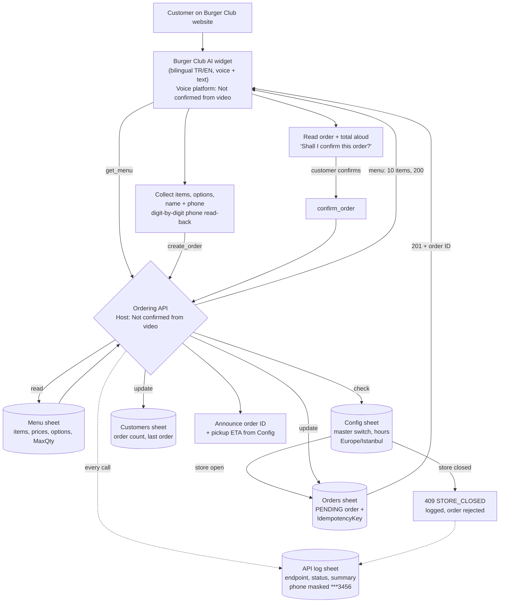

# Project Architecture — Burger Club ZAVIQUE Voice Ordering

> Architecture reconstructed **only** from the demonstration video. Components the video does not identify — the voice platform and the API host/implementation — are drawn as unconfirmed elements and labelled **"Not confirmed from video."** No orchestration canvas (e.g. n8n) appears in the video, and none is claimed.

---

## 1. Architecture Overview

The system has four layers:

| # | Layer | What the video shows |
|---|---|---|
| 1 | **Customer layer** | A visitor on the Burger Club ZAVIQUE website, speaking or typing |
| 2 | **Conversation layer** | The "Burger Club AI" widget (bilingual TR/EN; states: Connecting / Talk to interrupt / Listening; typed input). Underlying voice platform: **Not confirmed from video** |
| 3 | **Ordering API layer** | Three evidenced operations — `get_menu`, `create_order`, `confirm_order` — behaving like an HTTP API (status codes 200/201/409, request IDs, error codes). Host & implementation: **Not confirmed from video** |
| 4 | **Data layer** | Google Sheets workbook "Burger Club Orders (ZAVIQUE)": Menu, Orders, Customers, Config, API log |

Design characteristics visible from the evidence:

- **Spreadsheet-as-backend:** menu, orders, customers, configuration, and logs all live in one Google Sheets workbook — no database server is shown or needed at this scale.
- **Two-phase order commit:** orders are created *pending* and only confirmed after a verbal read-back — a conversational equivalent of a two-phase commit.
- **Idempotency:** the Orders sheet carries an `IdempotencyKey`, so a retried `create_order` call cannot silently duplicate an order.
- **Guard-first writes:** `create_order` checks store state (master switch + opening hours, Europe/Istanbul) before writing; violations return **409** with error code **`STORE_CLOSED`** and are logged.
- **Config-driven operations:** currency, delivery fee, minimum delivery subtotal, pending-order expiry, per-phone pending caps, and pickup/delivery ETAs are all sheet-maintained settings.
- **Full auditability:** every API call appends a row to the API log with request ID and outcome; phone numbers are masked in summaries (`***3456`).

## 2. Data Flow

```
1. Customer speaks/types an order in the website widget.
2. Assistant requests the menu           → API: get_menu        → reads Menu sheet
3. Assistant collects items + options, then name + phone
   (phone verified by digit-by-digit read-back).
4. Assistant submits the order            → API: create_order    → checks Config (open?)
                                                              → writes PENDING row in Orders
                                                              → 201 + order ID
5. Assistant reads order + total back; customer says "yes".
6. Assistant finalises                    → API: confirm_order   → Orders row → CONFIRMED
                                                              → Customers sheet updated
7. Assistant announces order ID + pickup ETA (from Config).
8. Every API call (steps 2, 4, 6 — success or failure) is appended to the API log sheet.
```

**Data at each boundary**

| Boundary | Data passed | Evidenced by |
|---|---|---|
| Customer → Widget | Voice audio / typed text; order intent; name; phone | Conversation in video |
| Widget → API (`get_menu`) | Menu request (exact parameters Not confirmed from video) | API log rows |
| API → Widget (`get_menu`) | Menu items with bilingual names, prices (TRY), options | Menu sheet + log summary "menu returned: 10 items" |
| Widget → API (`create_order`) | Customer name, phone, order type, items; idempotency key | Orders sheet columns; log summary |
| API → Widget (`create_order`) | 201 + order ID BC-261016-34KD, total 715.00 TRY — or 409 + `STORE_CLOSED` | API log rows |
| Widget → API (`confirm_order`) | Order ID | API log row |
| API → Sheets | Order row, customer record, log rows | Sheets in video |

## 3. Integration Overview

| Integration | Role | Evidence | Status |
|---|---|---|---|
| Restaurant website | Hosts the ordering widget; pages: Home, Menu, Order & Track, Zavique Club | Shown throughout | Confirmed (visual) |
| Voice assistant widget ("Burger Club AI") | Conversation front-end, TR/EN, voice + text | Shown throughout | Confirmed (visual); **platform Not confirmed from video** |
| Ordering API (`get_menu`, `create_order`, `confirm_order`) | Menu serving, guarded order creation, confirmation | API log sheet | Endpoints confirmed; **host/implementation Not confirmed from video** |
| Google Sheets | Data store for menu, orders, customers, config, logs | Workbook shown in video | Confirmed |
| Payment provider | — | No payment step appears in the video | **Not present in evidence** |
| SMS / messaging | — | No messaging step appears in the video | **Not present in evidence** |
| Automation/orchestration tool (e.g. n8n) | — | No canvas or tool name appears in the video | **Not confirmed from video — not claimed** |

## 4. Mermaid Flowchart

Only video-supported components are shown as solid nodes; unconfirmed elements are labelled as such.



## 5. Order State Model (as evidenced)

```
            create_order (store open)        confirm_order
  (none) ───────────────────────────────▶ PENDING ──────────────▶ CONFIRMED
                                              │
                                              │ pending window expires
                                              │ (Config: minutes a pending
                                              ▼  order stays confirmable)
                                          (expired — behaviour
                                           Not confirmed from video)

  create_order while store closed ──▶ rejected: 409 STORE_CLOSED (no order written)
```

## 6. Architectural Notes & Honesty Boundaries

- The video proves the **contracts** (endpoints, status codes, sheet schemas, config keys, conversation behaviour) but not the **implementation**. The API could be implemented in any stack that can read/write Google Sheets; this document deliberately does not name one.
- Because the data layer is a spreadsheet, throughput and concurrency limits are those of Google Sheets — appropriate for a single restaurant's order volume, as demonstrated.
- Security-relevant behaviour that *is* evidenced: phone masking in logs, idempotent order creation, pending-order expiry, and per-phone pending-order caps (an anti-abuse control).
