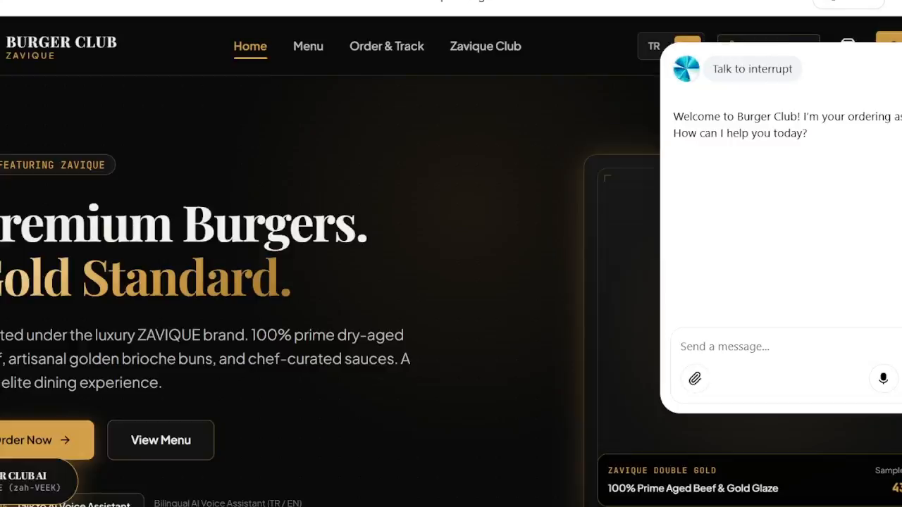

# Burger Club — ZAVIQUE: Bilingual AI Voice Ordering Assistant

> An AI voice assistant on a burger restaurant's website that takes complete food orders by voice — in Turkish or English — prices them from a live, spreadsheet-powered menu, and records every order, customer, and API call in Google Sheets.



*The Burger Club ZAVIQUE storefront with the "Burger Club AI" voice ordering widget open.*

---

## Overview

**Burger Club — ZAVIQUE** is a premium burger restaurant concept (100% prime dry-aged beef, artisanal golden brioche buns, chef-curated sauces). Its website carries an embedded voice assistant, **"Burger Club AI"**, labelled on the site as a *"Bilingual AI Voice Assistant (TR / EN)"*.

In the demonstration video, a customer completes a full order by voice alone:

1. The assistant greets the customer and takes the order: **two Zavique Classics with extra cheese and one classic fries, for pickup**.
2. It collects the customer's name and phone number, and **reads the phone number back digit-by-digit** for verification.
3. It reads the complete order back with the total — **715 Turkish Lira** — and asks *"Shall I confirm this order?"*
4. After the customer confirms, it announces the order ID — **BC-261016-34KD** — and a pickup estimate of **approximately 15 minutes**.

Behind the conversation, an ordering API backed by a Google Sheets workbook (**"Burger Club Orders (ZAVIQUE)"**) serves the menu, creates the order in a *pending* state, and finalises it on confirmation — logging every request, including rejected ones, with status codes and error codes.

> **Evidence note:** This documentation is based solely on the project's demonstration video. The video shows the website, the voice conversation, and the Google Sheets backend. It does **not** show the internal implementation of the API or the voice platform — see [PROJECT-LIMITATIONS.md](PROJECT-LIMITATIONS.md) and the "Not confirmed from video" notes throughout.

## The Business Problem

Restaurant phone and counter ordering has well-known friction points, all visible in what this system is designed to handle:

- **Missed and rushed orders** — staff can only take one call at a time; peak-hour callers wait or hang up.
- **Order errors** — names, phone numbers, and item options (e.g. extra cheese) are easily misheard, with no read-back step.
- **Menu inconsistency** — prices and availability quoted from memory drift from the actual menu.
- **No audit trail** — a verbal order leaves no structured record of what was ordered, by whom, for how much, or what went wrong.
- **Language barriers** — a bilingual customer base (Turkish/English) needs staff fluent in both.

## The Solution

A voice-first ordering channel embedded directly in the restaurant's own website:

- The assistant converses naturally, in **Turkish or English**, and can also accept **typed messages** (the widget includes a "Send a message…" input).
- The menu, prices, options, and availability live in a **Google Sheets `Menu` sheet** — the restaurant can edit prices or mark items unavailable without touching code.
- Orders follow a safe **two-step flow**: `create_order` first creates a **pending** order; only after the assistant reads the order back and the customer verbally confirms does `confirm_order` finalise it.
- Business rules (opening hours, delivery fee, minimum delivery subtotal, pending-order expiry, per-phone pending caps) live in a **Config sheet**, so operations can be tuned without a developer.
- Every API call is written to an **API log sheet** with endpoint, request ID, status code, success flag, error code, and a human-readable summary — including masked customer phone numbers (`***3456`).

## Key Features

All features below are visible in the demonstration video.

| Feature | Evidence in video |
|---|---|
| Bilingual voice ordering (TR / EN) | Widget labelled "Bilingual AI Voice Assistant (TR / EN)"; site has a TR language toggle; menu stores names/descriptions in both languages |
| Voice + text input | Widget states ("Connecting", "Talk to interrupt", "Listening") and a "Send a message…" typed input |
| Live menu from Google Sheets | `Menu` sheet with 10 items, bilingual names/descriptions, prices, availability flags, per-item `OptionsJSON` (e.g. `extra_cheese`, size `large`) and `MaxQty` caps |
| Guided data collection | Assistant asks for name and phone, then reads the phone back digit-by-digit before proceeding |
| Two-step order safety | Order is created **pending** (`create_order` → HTTP 201), read back to the customer with the total, and only then confirmed (`confirm_order` → HTTP 200) |
| Idempotent order creation | `Orders` sheet includes an `IdempotencyKey` column |
| Store open/closed guard | Config master switch + opening hours (Europe/Istanbul); log shows `create_order` rejected with HTTP 409 and error code `STORE_CLOSED` — *"The restaurant is not accepting orders right now."* |
| Order & customer records | `Orders` sheet stores the full order (items as JSON, subtotal, delivery fee, total, currency); `Customers` sheet tracks order count, first seen, last order |
| Full API audit log | Log sheet records endpoint, request ID, order ID, status code, success, error code, and summary for every call |
| Privacy-conscious logging | Phone numbers appear masked in log summaries (`phone ***3456`) |
| Pickup/delivery estimates | Config-driven pickup estimate (15 minutes quoted in the demo) and delivery estimate |

## Technologies Used

| Layer | Technology | Status |
|---|---|---|
| Storefront | Burger Club ZAVIQUE website (Home, Menu, Order & Track, Zavique Club) | Shown in video |
| Voice assistant front-end | "Burger Club AI" website widget (voice + typed input) | Shown in video; **underlying voice platform: Not confirmed from video** |
| Ordering API | HTTP-style endpoints `get_menu`, `create_order`, `confirm_order` returning status codes 200 / 201 / 409 | Endpoints evidenced by the API log; **API host/implementation: Not confirmed from video** |
| Data layer | Google Sheets workbook "Burger Club Orders (ZAVIQUE)" — sheets: Menu, Orders, Customers, Config, API log | Shown in video |
| Menu/order data format | JSON fields in-sheet (`OptionsJSON`, `ItemsJSON`) | Shown in video |
| Business timezone | Europe/Istanbul (config) | Shown in video |
| Orchestration layer | **Not confirmed from video** — the video does not show an automation canvas (e.g. n8n) or name one | See limitations |

## System Architecture

```
┌─────────────────────────────┐
│  Customer (voice or text)   │
└──────────────┬──────────────┘
               │
┌──────────────▼──────────────┐
│  Burger Club website        │
│  "Burger Club AI" widget    │   ← voice platform: Not confirmed from video
└──────────────┬──────────────┘
               │  API calls (host: Not confirmed from video)
┌──────────────▼──────────────┐
│  Ordering API               │
│  get_menu · create_order    │
│  confirm_order              │
└──────────────┬──────────────┘
               │  reads / writes
┌──────────────▼──────────────┐
│  Google Sheets workbook     │
│  "Burger Club Orders        │
│   (ZAVIQUE)"                │
│  Menu · Orders · Customers  │
│  Config · API log           │
└─────────────────────────────┘
```

See [PROJECT-ARCHITECTURE.md](PROJECT-ARCHITECTURE.md) for the full architecture, data flow, and a Mermaid diagram, and [WORKFLOW-EXPLANATION.md](WORKFLOW-EXPLANATION.md) for the step-by-step request lifecycle.

## How an Order Flows (step by step)

1. **Greeting & intent** — The assistant opens with *"Welcome to Burger Club! I'm your ordering assistant. How can I help you today?"*
2. **Menu lookup** — The assistant prices items from the live menu (`get_menu` → 200, *"menu returned: 10 items"*).
3. **Order capture** — Items, quantities, and options (e.g. extra cheese) are collected conversationally; order type is pickup or delivery.
4. **Customer details** — Name and phone are collected; the phone is **read back digit-by-digit** and corrected/confirmed before use.
5. **Pending order created** — `create_order` writes the order to the `Orders` sheet in a pending state (201, *"pending created BC-261016-34KD 715.00 TRY phone \*\*\*3456"*). If the store is closed or the master switch is off, the call is rejected (409, `STORE_CLOSED`) and nothing is sold.
6. **Read-back & confirmation** — The assistant reads the full order and total aloud: *"Your order is for two Zavique Classics with extra cheese and one classic fries, totaling seven hundred and fifteen Turkish Lira. Shall I confirm this order?"*
7. **Order confirmed** — On the customer's "yes", `confirm_order` finalises the order (200, *"confirmed BC-261016-34KD phone \*\*\*3456"*); the `Customers` sheet is updated with the customer's order history.
8. **Completion** — The assistant announces the order ID and the pickup estimate: *"Your order is confirmed! … It will be ready for pickup in approximately fifteen minutes."*
9. **Audit** — Every call above appears in the API log sheet with its request ID, status code, and summary.

**Demo order arithmetic (from the Menu sheet):** 2 × Zavique Classic (285 TRY) + Classic Fries (95 TRY) + extra-cheese options = **715 TRY total**, delivery fee 0 (pickup).

## Screenshots

| Asset | What it shows | Source |
|---|---|---|
| [assets/project-demo-thumbnail.png](assets/project-demo-thumbnail.png) | The ZAVIQUE storefront hero ("Premium Burgers. Gold Standard.") with the Burger Club AI widget mid-conversation | Video ~0:02 |
| [assets/workflow-overview.png](assets/workflow-overview.png) | **Data-layer overview** — the `Menu` sheet of the "Burger Club Orders (ZAVIQUE)" workbook (no workflow canvas is shown in the video; see limitations) | Video ~0:35 |
| [assets/execution-result.png](assets/execution-result.png) | The API log sheet: `get_menu` 200 responses, `create_order` 201 *"pending created BC-261016-34KD 715.00 TRY"*, `confirm_order` 200, and 409 `STORE_CLOSED` rejections | Video ~0:38 |

## Demo Video

📹 **Demo video link:** _[Add link here — see demo/VIDEO-LINK.md](demo/VIDEO-LINK.md)_

The 40-second demonstration shows the live voice order end-to-end and the resulting records in Google Sheets. Key moments are timestamped in [demo/VIDEO-LINK.md](demo/VIDEO-LINK.md).

## Setup Summary

A high-level recreation path (full detail in [SETUP-GUIDE.md](SETUP-GUIDE.md)):

1. Create the Google Sheets workbook with the five sheets (Menu, Orders, Customers, Config, API log) and the columns documented in [WORKFLOW-EXPLANATION.md](WORKFLOW-EXPLANATION.md).
2. Populate the Menu sheet (bilingual names/descriptions, prices, availability, `OptionsJSON`, `MaxQty`) and the Config sheet (store switch, hours, currency, delivery fee, minimums, estimates).
3. Expose the three API operations — `get_menu`, `create_order`, `confirm_order` — from a backend of your choice (**the original backend implementation is Not confirmed from video**).
4. Connect a bilingual voice-assistant widget to the website and wire it to the API (**the original voice platform is Not confirmed from video**).
5. Test the full pending → confirmed flow and the closed-store rejection before going live.

No credentials, API keys, or secrets are included anywhere in this repository.

## Use Cases

- **Burger / fast-casual restaurants** that want after-hours and peak-hour ordering without extra phone staff.
- **Bilingual markets** (e.g. Turkish/English) where one assistant must serve both languages from one menu.
- **Small restaurants** that need a real order system with zero database infrastructure — everything runs on Google Sheets.
- **Franchise / multi-branch concepts** where menu and rules are edited centrally in a spreadsheet.
- **Order-error reduction** — digit-by-digit phone read-back and full order read-back before confirmation.

## Limitations

Summary (full disclosure in [PROJECT-LIMITATIONS.md](PROJECT-LIMITATIONS.md)):

- This documentation is reconstructed **from the demonstration video only**; no source code, workflow export, or live link was provided.
- The **voice platform and API host/implementation are Not confirmed from video**; the video shows no automation canvas, and no specific orchestration tool (including n8n) is claimed for this project.
- **Menu prices in the video are example data** — the Menu sheet itself flags them (`PriceIsExample = TRUE`) and descriptions read "Sample description".
- The demo customer details are illustrative; phone numbers are masked in this documentation exactly as the system's own log masks them (`***3456`).
- Exact internal validation rules beyond those evidenced (config keys, log entries, sheet columns) are not verifiable from the video.

## Future Improvements

Suggestions only — none of these are shown in the video:

- Order-status tracking page wired to the site's existing "Order & Track" section.
- SMS or WhatsApp confirmation to the customer after `confirm_order`.
- A staff dashboard / kitchen display fed from the Orders sheet.
- Delivery-address validation and delivery-zone rules for delivery orders.
- Speech-language auto-detection at conversation start.
- Moving the data layer from Google Sheets to a database for higher order volumes.

## Author

**Fahad Ahmed Shanawar**
Agentic AI Architect — designing autonomous AI agents & intelligent automation systems

- GitHub: https://github.com/AiwithFahad
- LinkedIn: https://www.linkedin.com/in/fahad-ahmed-shanawar-107a5535a/
